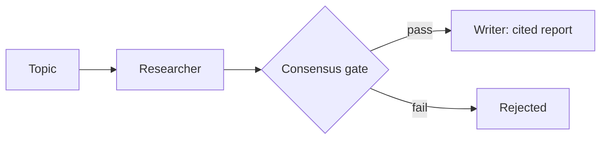

# Multi-Agent Research Desk


**Researcher + Writer + Fact-Checker with consensus logic — no claim publishes without passing a citation check (lexical overlap + number match against its source, plus an independent citation-store existence check).**

**Target:** 1 published report, every claim cited and citation-checked.
**Shows:** You orchestrate teams of agents, not toys.

## Problem → Solution

Single-agent research drafts read well and cite badly. This desk splits the
work: a Researcher grounds claims in sources, a Fact-Checker citation-checks
each claim against its source (≥40% content-term overlap, every numeral in
the claim must appear in the source, negation must match), and a Writer may
only publish claims that pass consensus — the fact-check vote AND an
existence check in a separate CitationStore (two independent lookups, not
one counted twice). Rejected claims are excluded, never quietly published.
A topic with no matching sources yields an empty report, not invented
claims. It runs fully offline on a seeded mock search backend.

## Architecture



See [docs/ARCHITECTURE.md](docs/ARCHITECTURE.md).

## Quickstart (<2 min)

```bash
git clone https://github.com/lionelsimai/multi-agent-research-desk && cd multi-agent-research-desk
pip install -e .
python -m research_desk.cli demo
python -m research_desk.cli report --topic "AI agents enterprise research" --out examples/sample-report.md
python -m pytest -q   # 16 passed
```

The one published sample report is [examples/sample-report.md](examples/sample-report.md) (5 claims, 100% citation-checked).

## Real demo output

```text
Published claims: 4 | Rejected: 0 | Citation coverage: 100%
```
(topic: "AI agents enterprise"; the sample report topic yields 5 claims.)

## Benchmarks

```bash
python benchmarks/bench_citations.py
```
Measured in this build (0.1.1):

```text
Published claims: 5  Rejected: 0
Citation coverage (citation-checked): 100%
Fabricated claim rejected by consensus: True
Figure-flipped claim (72 -> 27) rejected: True
No-source topic published claims: 0 (must be 0)
```

Before 0.1.1 the benchmark reported the same 100% coverage, but a topic
with no matching sources (even an empty topic) published 5 claims via a
full-corpus fallback, and figure-flipped claims passed the word-overlap
check. Both holes are closed and probed above.

## Limitations (honest)

- The search backend and source corpus are seeded mocks (5 sources,
  example.org) — they prove the orchestration and gate, not research breadth.
- The citation check is a lexical heuristic (>=40% content-term overlap)
  plus numeral-match and negation-parity checks — it is *not* semantic
  verification/entailment; a real deployment needs a stronger checker.
  "Citation-checked" in this README means exactly those three checks.
- Claim drafting is templated per source in the offline build; LLM drafting
  slots in behind the same consensus gate (see Architecture).

## Roadmap

- [x] 3 roles, consensus gate, citation store, offline report generator, sample report
- [x] Number-aware + negation-aware citation check; no-source topics publish empty reports; independent CitationStore consensus
- [ ] Real search adapter (same search/get/verify interface)
- [ ] LLM drafting + entailment-based fact-checker; multi-round revision loop

## Contributing

See [CONTRIBUTING.md](CONTRIBUTING.md). Licence: MIT — see [LICENSE](LICENSE).
