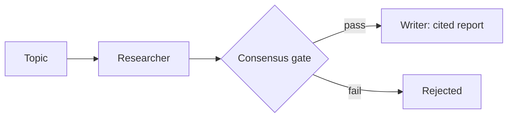

# Multi-Agent Research Desk


**Researcher + Writer + Fact-Checker with consensus logic — no claim publishes without a verified citation.**

**Target:** 1 published report, every claim cited and verified.
**Shows:** You orchestrate teams of agents, not toys.

## Problem → Solution

Single-agent research drafts read well and cite badly. This desk splits the
work: a Researcher grounds claims in sources, a Fact-Checker independently
verifies each claim against its citation, and a Writer may only publish
claims that pass consensus (fact-check vote AND source exists). Rejected
claims are excluded, never quietly published. It runs fully offline on a
seeded mock search backend.

## Architecture



See [docs/ARCHITECTURE.md](docs/ARCHITECTURE.md).

## Quickstart (<2 min)

```bash
git clone https://github.com/lionelsimai/multi-agent-research-desk && cd multi-agent-research-desk
pip install -e .
python -m research_desk.cli demo
python -m research_desk.cli report --topic "AI agents enterprise research" --out examples/sample-report.md
python -m pytest -q   # 11 passed
```

The one published sample report is [examples/sample-report.md](examples/sample-report.md) (5 claims, 100% verified citations).

## Real demo output

```text
Published claims: 4 | Rejected: 0 | Citation coverage: 100%
```
(topic: "AI agents enterprise"; the sample report topic yields 5 claims.)

## Benchmarks

```bash
python benchmarks/bench_citations.py
```
Measured in this build: citation coverage 100% on the sample report, and a
fabricated claim ("Unicorns founded 900 startups…") is rejected by consensus.

## Limitations (honest)

- The search backend and source corpus are seeded mocks (5 sources,
  example.org) — they prove the orchestration and gate, not research breadth.
- Verification is a lexical-support heuristic (>=40% content-term overlap),
  not semantic entailment; a real deployment needs a stronger checker.
- Claim drafting is templated per source in the offline build; LLM drafting
  slots in behind the same consensus gate (see Architecture).

## Roadmap

- [x] 3 roles, consensus gate, citation store, offline report generator, sample report
- [ ] Real search adapter (same search/get/verify interface)
- [ ] LLM drafting + entailment-based fact-checker; multi-round revision loop

## Contributing

See [CONTRIBUTING.md](CONTRIBUTING.md). Licence: MIT — see [LICENSE](LICENSE).
