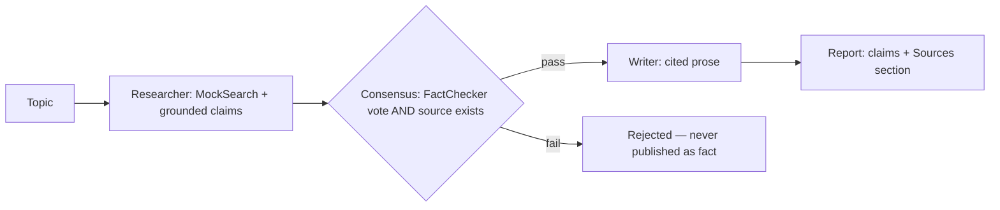

# Architecture

## Components
- **Sources** (`sources.py`): `Source` records, a seeded offline corpus, `MockSearch` (keyword ranking with a crude singular stem), and `verify()` — a claim is supported only if >=40% of its content terms appear in the cited source.
- **Agents** (`agents.py`): `Researcher` drafts one grounded claim per source; `FactChecker` independently verifies each claim against its citation; `Writer` renders *verified* claims only.
- **Desk** (`desk.py`): consensus = fact-check vote passes AND the cited source exists. `Report.citation_coverage` is the fraction of published claims that are verified + cited (target 1.0).
- **CLI** (`cli.py`): `report --topic ... --out file.md` and `demo`.
- **Config** (`config.py`): environment-based settings (`RESEARCH_DESK_*`).

## Swapping in real search / LLMs
Replace `MockSearch` with any object exposing `search/get/verify` and replace the claim templates in `agents.py` with LLM drafting — the consensus gate and report contract stay identical.
