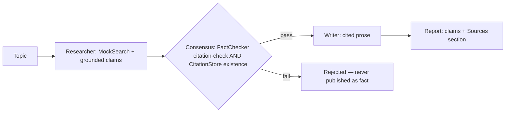

# Architecture

## Components
- **Sources** (`sources.py`): `Source` records, a seeded offline corpus, `MockSearch` (keyword ranking with a crude singular stem), and `verify()` — the citation check: >=40% of the claim's content terms appear in the cited source, every numeral in the claim appears in the source (figure-flips fail), and negation parity matches. Also `CitationStore`: a separately built id->Source registry used for existence checks, independent of the search ranking path.
- **Agents** (`agents.py`): `Researcher` drafts one grounded claim per source found — no fallback, so a topic with no sources produces no claims; `FactChecker` citation-checks each claim against its source; `Writer` renders only claims that passed consensus, with the topic escaped for markdown.
- **Desk** (`desk.py`): consensus = FactChecker citation-check passes AND the citation exists in the CitationStore — two independent lookups. `Report.citation_coverage` is the fraction of published claims that passed the check + are cited (target 1.0). A no-source topic yields an empty report stating that no sources were found.
- **CLI** (`cli.py`): `report --topic ... --out file.md` and `demo`.
- **Config** (`config.py`): environment-based settings (`RESEARCH_DESK_*`).

## Swapping in real search / LLMs
Replace `MockSearch` with any object exposing `search/get/verify` and replace the claim templates in `agents.py` with LLM drafting — the consensus gate and report contract stay identical.
